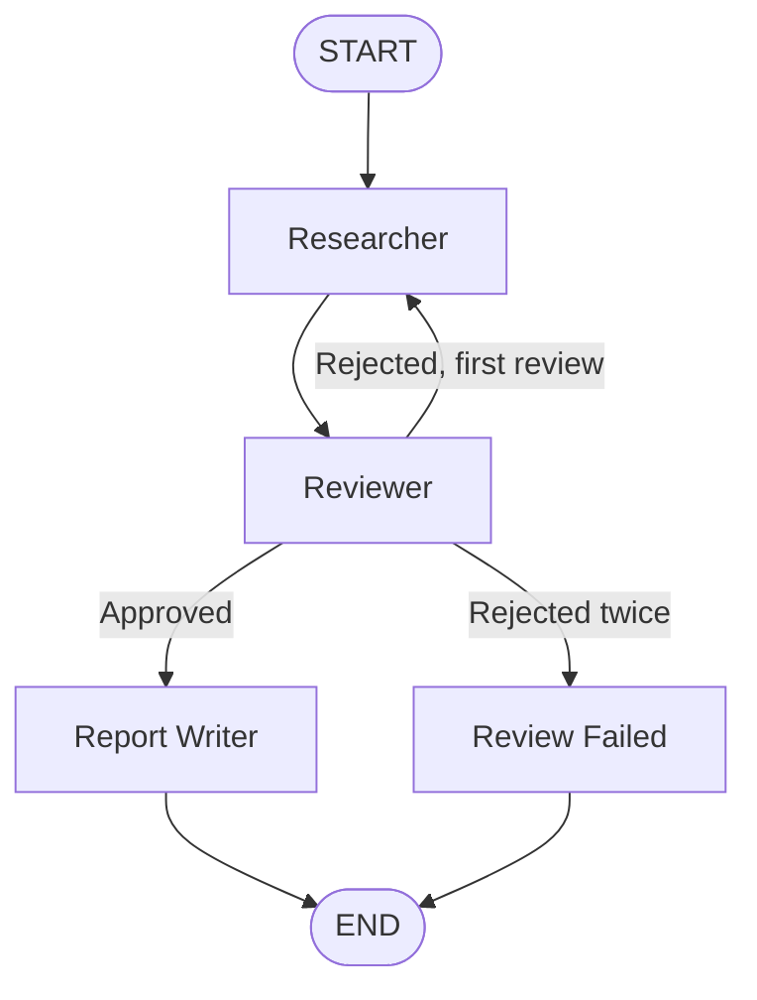

# Multi-Agent Workflow with LangGraph

## Project Overview

This project demonstrates a multi-agent workflow using Python,
LangGraph, and a local Ollama LLM.

Three specialised agents work together to create a research report.
A reviewer can approve the research or reject it and send it back
for revision.

## Agents

1. **Researcher** — Generates research on the given topic.
2. **Reviewer** — Reviews clarity, evidence, risks, and limitations.
3. **Report Writer** — Creates the final report after approval.

A fourth node, `review_failed`, handles research that is rejected
twice.

## Architecture Diagram

## Shared State

The workflow uses an `AgentState` TypedDict with these fields:

- `topic`: Research topic
- `research`: Research generated by the Researcher
- `fact_check`: Reviewer's response
- `final_report`: Final report or failure message
- `review_status`: Approval or rejection status
- `review_count`: Number of reviews
- `feedback`: Review feedback for revision

## Technology Stack

- Python
- LangGraph
- LangChain Ollama integration
- Ollama
- Llama 3.1 (8B)

## How to Run

1. Install Python and Ollama.
2. Download the model using:

   `ollama pull llama3.1:8b`

3. Install dependencies:

   `pip install langgraph langchain-ollama`

4. Run the workflow:

   `python workflow.py`

5. Enter a research topic when prompted.

Make sure Ollama is running before starting the workflow.

## Failure Mode

If the Reviewer rejects the research twice, the workflow routes
to the `review_failed` node and stops without generating an
approved final report.

The last review feedback is included in the failure message.

## Limitations

- The Reviewer uses an LLM to review the research.
- Independent external fact verification is not implemented.
- LLM review decisions may be inconsistent.
